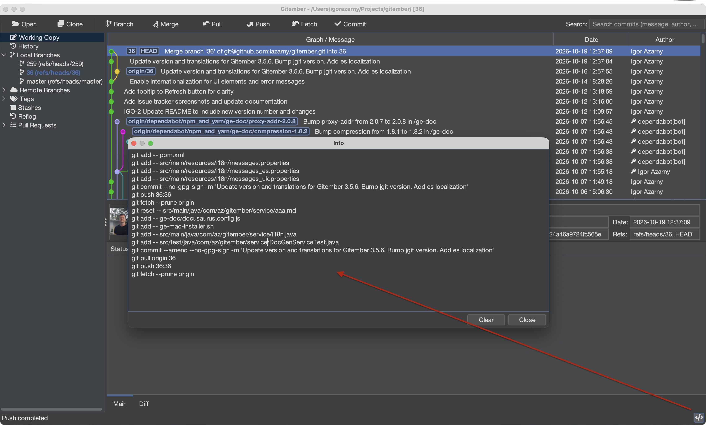

# Show Git Command

Every time you stage a file, commit, pull or create a branch in Gitember, the same thing
could have been done with a `git` command in a terminal. Gitember writes that command down
for you. Open the list and you see the command line for everything you did in this repository.

We built this for people who are learning Git. It is also handy when you have
used Git for years and just want to check what a button actually does before you trust it.

## Where to find it

Open a repository. A small **`</>`** button appears at the right end of the status bar,
at the bottom of the main window. Click it.



A window called **Info** opens with one command per line, oldest first:

```text
git add src/main/java/com/example/PaymentService.java
git commit -m "PAY-123 Fix payment timeout"
git checkout -b feature/PAY-124-retry-policy
git push origin feature/PAY-124-retry-policy
```

You can select the text and copy it, for example into a script or a note for a colleague.

- **Clear** empties the list and closes the window. Use it before trying something, so you
  only see the commands for that one action.
- **Close** (or `Esc`) closes the window and keeps the list.

The list belongs to the repository that is open. When you open another repository you
start with an empty list. Nothing is saved to disk.

## A good way to learn with it

1. Open the window and click **Clear**.
2. Do one thing in Gitember: stage a file, pull with rebase, delete a tag.
3. Open the window again and read the command.
4. Look up any flag you don't know in `git help <command>`.

After a few days you will find that you can guess the command before you open the window.
Then you can try it in a terminal yourself and compare.

## What it covers

Gitember shows commands for the everyday operations:

| Area | Commands |
|------|----------|
| Working copy | `add`, `rm`, `reset`, `checkout`, `apply`, `diff` |
| Commits | `commit`, `log` |
| Branches | `branch` (create, rename, delete), `merge`, `rebase` |
| Remotes | `fetch`, `pull`, `push` |
| Tags | `tag`, `tag -d` |
| Stash | `stash push`, `stash apply`, `stash drop` |
| Notes | `notes add`, `notes remove` |
| Submodules | `submodule add`, `init`, `update`, `sync`, `status`, `deinit` |
| Maintenance | `gc` |

Options are carried over where Git has them. A pull with rebase shows up as
`git pull --rebase`, a merge without fast-forward as `git merge --no-ff`, a force push as
`git push --force`, and so on. Paths and messages with spaces are quoted, so the line can be
pasted into a shell.

Some actions don't show anything yet. That is the case for operations that only read data
to draw the screen, and for a few less common commands. We keep adding them.

## Things to know

Gitember does not start the `git` program to do its work. It uses
[JGit](https://www.eclipse.org/jgit/), a Git library written in Java. The command you see is
what you would type to get **the same result** with command-line Git. It is not a copy of a
process that ran on your machine.

In practice the result is the same. Still, keep a couple of things in mind:

- Gitember sometimes does one action in several steps. You will see several lines then, for
  example `git add` for the new name and `git rm` for the old one when you rename a file.
- The command is recorded when the operation starts. If the operation fails, for example a
  push is rejected, the line is still in the list.
- Passwords and tokens are never part of the command. Remote names and URLs are.

## Why "Show Git Command"

GUI clients are good at hiding Git. That is nice until something goes wrong, you open a
terminal and you don't know what to type. Gitember tries to work the other way: use the
buttons, and pick up the commands along the way. You don't have to memorize anything up
front.
